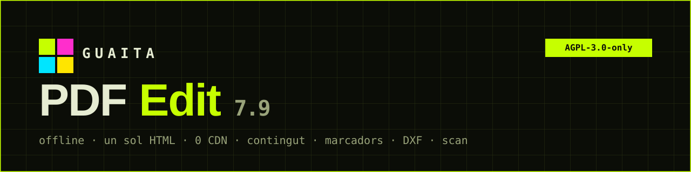

<!-- SPDX-License-Identifier: AGPL-3.0-only · Copyright (c) 2026 SBS BiM Consulting, Jordi Subirós -->

<b>🇨🇦 <a href="#català">Català</a></b> · <b>🇬🇧 <a href="#english">English</a></b>

---

## Català

**Guaita PDF Edit** és un editor de PDF multidocument en **un sol fitxer HTML**: no instal·la res, no es connecta a cap servidor i funciona sense Internet. Els teus PDF no surten mai de l'ordinador. Forma part de la suite **Guaita Apps**.

### Funcions

| | |
|---|---|
| 📄 **Pàgines** | Reordena, gira, duplica, extreu, elimina, insereix; copia/enganxa entre documents; fusiona pestanyes |
| 👁 **Vistes** | Pàgina única, llibre, continu i continu en dues columnes; **Organitzador de pàgines** (arrossega per reordenar, mida S/M/L); **cintes de marcadors** vermelles al marge de cada pàgina marcada |
| ✍ **Anotacions** | Llapis, ressaltador, text, formes, signatura, imatges, marca d'aigua, numeració, mesura a escala |
| ✎ **Contingut original** | Edita text amb la font incrustada, **combina** lletres originals amb una font de reemplaçament, i elimina/substitueix/mou imatges |
| 🔖 **Marcadors** | Lectura, creació, edició, arrossegar i niar, navegació, panell lateral; es desen dins el PDF; **índex a partir dels marcadors** amb enllaços |
| 💬 **Revisar i signar** | Notes, núvols, fletxes i segells amb respostes i estats; signatura, inicials i circuit d'aprovació; certificats amb clau EC |
| 🧩 **Composar** | Arbre de nodes per combinar PDF (estil Grasshopper): nodes d'**edició**, de **generació** (portada, separador, índex, en blanc) i de **document** (aplanar, capes, metadades, adjunts); processament per **lots**, grups, notes, clústers i plantilles |
| 🗜 **Dividir i reduir** | Pàgines › Dividir el document en diversos fitxers; Reduir la mida (imatges, metadades, miniatures, JavaScript…) |
| 📋 **Aplicar a altres pàgines** | Copia una anotació, segell o capçalera/peu a les pàgines que triïs (totes, parells, senars, interval) |
| 📐 **Exporta a DXF** | Geometria vectorial → DXF R12, capes per color, unitats i escala calibrable (sense dependre de cap altra app) |
| 🛡 **guaitaPDFscan** | Analitza i desarma un PDF sospitós en una finestra aïllada; l'editor només rep el PDF net |
| 🖨 **Impressió** | Previsualització amb paper, orientació i escala (com Acrobat) |
| 🌐 **Idiomes** | Català i anglès |

### Fitxers

| Fitxer | Ús |
|---|---|
| `guaita_pdf_edit_7.3.2.html` | Editor (obre al navegador) |
| `guaitaPDFscan_1.3.html` | Analitzador; **ha de ser a la mateixa carpeta** |
| `guaita_pdf_edit_7.3.2_EN.html` + `guaitaPDFscan_1.3_EN.html` | Versió anglesa (mateixa carpeta) |

### Ús

1. Descarrega els fitxers a **una mateixa carpeta**.
2. Fes doble clic a `guaita_pdf_edit_7.3.2.html`.
3. Obre o arrossega un o diversos PDF.

Per a l'analitzador, el navegador ha de permetre finestres emergents. També es pot servir per **GitHub Pages** (fitxers estàtics, HTTPS, editor i analitzador al mateix directori).

📘 **Manual complet:** [`HLP guaitaPDFedit-ajuda.html`](HLP%20guaitaPDFedit-ajuda.html)

### Limitacions conegudes

La navegació de marcadors va a la pàgina (no a la posició exacta); «Insereix des de PDF» no importa marcadors; el DXF no exporta imatges ni degradats.

---

## English

**Guaita PDF Edit** is a multi-document PDF editor in **a single HTML file**: it installs nothing, talks to no server and works offline. Your PDFs never leave your computer. Part of the **Guaita Apps** suite.

### Features

| | |
|---|---|
| 📄 **Pages** | Reorder, rotate, duplicate, extract, delete, insert; copy/paste across documents; merge tabs |
| 👁 **Views** | Single page, book, continuous and two-column continuous; **Page organiser** (drag to reorder, S/M/L size); red **bookmark ribbons** on the margin of each bookmarked page |
| ✍ **Annotations** | Pencil, highlighter, text, shapes, signature, images, watermark, page numbers, scaled measuring |
| ✎ **Original content** | Edit text with the embedded font, **combine** original letters with a replacement font, delete/replace/move images |
| 🔖 **Bookmarks** | Read, create, edit, drag and nest, navigate, side panel; saved inside the PDF; **index from bookmarks** with links |
| 💬 **Review & sign** | Notes, clouds, arrows and stamps with replies and status; signature, initials and approval circuit; EC-key certificates |
| 🧩 **Compose** | Node tree to combine PDFs (Grasshopper-style): **edit**, **generate** (cover, separator, index, blank) and **document** nodes (flatten, layers, metadata, attachments); **batch** processing, groups, notes, clusters and templates |
| 🗜 **Split & reduce** | Pages › Split the document into several files; Reduce size (images, metadata, thumbnails, JavaScript…) |
| 📋 **Apply to other pages** | Copy an annotation, stamp or header/footer to the pages you choose (all, even, odd, range) |
| 📐 **Export to DXF** | Vector geometry → DXF R12, colour layers, units and calibrated scale (no other app needed) |
| 🛡 **guaitaPDFscan** | Analyse and disarm a suspicious PDF in an isolated window; the editor only receives the clean PDF |
| 🖨 **Print** | Preview with paper, orientation and scale (Acrobat-style) |
| 🌐 **Languages** | Catalan and English |

### Files

| File | Use |
|---|---|
| `guaita_pdf_edit_7.3.2.html` | Editor (opens in the browser) |
| `guaitaPDFscan_1.3.html` | Analyser; **must be in the same folder** |
| `guaita_pdf_edit_7.3.2_EN.html` + `guaitaPDFscan_1.3_EN.html` | English version (same folder) |

### Usage

1. Download the files into **one folder**.
2. Double-click `guaita_pdf_edit_7.3.2.html`.
3. Open or drop one or more PDFs.

The analyser needs the browser to allow pop-ups. It can also be served via **GitHub Pages** (static files, HTTPS, editor and analyser in the same directory).

📘 **Full guide:** [`HLP guaitaPDFedit-help_EN.html`](HLP%20guaitaPDFedit-help_EN.html)

### Known limitations

Bookmark navigation goes to the page (not the exact position); “Insert from PDF” does not import bookmarks; DXF export skips images and shadings.

---

## Components · Llicència · Licence

[pdf.js](https://mozilla.github.io/pdf.js/) 3.11.174 (Apache-2.0) · [pdf-lib](https://pdf-lib.js.org/) 1.17.1 (MIT) · [@pdf-lib/fontkit](https://github.com/Hopding/fontkit) 1.1.1 (MIT) — tots incrustats / all embedded.

Copyright © 2026 **SBS BiM Consulting, Jordi Subirós** · `SPDX-License-Identifier: AGPL-3.0-only`

> Guaita Apps es distribueix «tal com és», sense cap garantia. / Guaita Apps is distributed “as is”, without any warranty.
