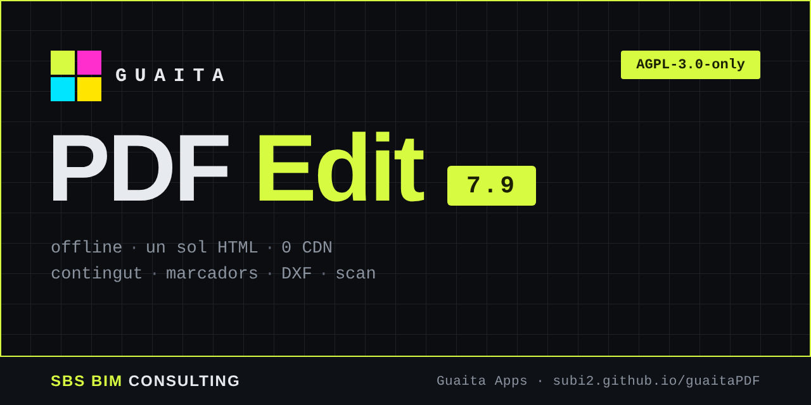

<!-- SPDX-License-Identifier: AGPL-3.0-only · Copyright (c) 2026 Jordi Subirós, SBS BIM Consulting -->

# Guaita PDF Edit — User guide

**Version 8.3.7** · 🇨🇦 [Versió en català](README_AJUDA.md) · ← Back to the [README](README.md)

Multi-document PDF editor in a single HTML file. It installs nothing, connects to no server and works offline: your PDFs never leave your computer. It includes original-content editing, review and signing, the Compose node canvas, scaled measurements, revision comparison, size reduction, DXF export and the suspicious-PDF analyser guaitaPDFscan.

## Contents

- [01. What it is](#01-what-it-is)
- [02. Working modes](#02-working-modes)
- [03. Open, save and print](#03-open-save-and-print)
- [04. Pages and view](#04-pages-and-view)
- [05. Annotations and measuring](#05-annotations-and-measuring)
- [06. Edit the original content](#06-edit-the-original-content)
- [07. Bookmarks](#07-bookmarks)
- [08. Review and sign](#08-review-and-sign)
- [09. Attachments, layers and properties](#09-attachments-layers-and-properties)
- [10. Compose: nodes](#10-compose-nodes)
- [11. Reduce size](#11-reduce-size)
- [12. Export to DXF](#12-export-to-dxf)
- [13. Analyse a suspicious PDF (guaitaPDFscan)](#13-analyse-a-suspicious-pdf-guaitapdfscan)
- [14. Install as an app](#14-install-as-an-app)
- [15. Keyboard shortcuts](#15-keyboard-shortcuts)
- [16. FAQ](#16-faq)

---

## 01. What it is

- **Local and private** — Everything is processed in the browser. No CDN, no server.
- **Multi-document** — Each PDF opens in its own tab; you can copy pages between documents.
- **Editing and review** — Original text and images, real PDF annotations, bookmarks and digital signature.
- **Compose** — A node canvas to combine, pick, sort, transform and split pages and batches of documents.

Components: pdf.js 3.11.174 (Mozilla, Apache-2.0), pdf-lib 1.17.1, @pdf-lib/fontkit 1.1.1 (MIT) and node-forge for signing, all embedded in the file.

## 02. Working modes

The switch in the header separates the ways of working:

| Mode | What it is for |
|---|---|
| **View** | Navigation, page views, hand, scaled measuring, search, export and printing. |
| **Explore** | Browser for the PDFs in a folder (with subfolders): first-page thumbnails without opening the files, search, peek and selective opening. Next to View. |
| **Notes** | For taking notes with a stylus or finger: pencils, highlighters, text, shapes and eraser, notebook paper, lasso, voice and links. Between View and Edit; also in Tools › Notes mode. |
| **Edit** | Tools by family (History, Pages, Content, Annotate, Insert) and, below, the options of the active tool. Editing-tool shortcuts take you to this mode by themselves. |
| **Review** | Real PDF annotations (notes, text markups, clouds, stamps, attachments) with list, filters and export. |
| **Sign** | Digital signature with a .p12/.pfx certificate, signature fields and signer circuits. |
| **Compose** | Grasshopper-style node canvas to organise documents and pages. |
| **Scan** | The guaitaPDFscan suspicious-PDF analyser, inside an isolated frame. |

### Notes mode

- **Tools**: hand, select, **lasso**, pencils and ballpoints, highlighters, highlight text, highlight rectangle, text (box and in-place), shapes and eraser. The Edit-mode tools are unchanged.
- **Stylus and finger**: the stylus draws with pressure and a stabiliser; the finger pans the page and two fingers zoom (the *Finger* button makes it draw); the palm is rejected while the stylus is nearby; swiping changes page when the page fits entirely.
- **Erasers**: whole stroke, circular or square, with adjustable size. The *Also PDF originals* option removes original images; the rest of the original content is covered with white (it stays underneath).
- **Screen**: neighbouring pages, thumbnails and full screen with a draggable floating bar.
- **Paper and notebook (7.7.1)**: blank pages can have ruled, grid or dotted paper (spacing in mm; vector lines in the PDF). The *Notebook* tab of the side panel shows sections (top-level bookmarks, with colour) and pages, which can be added, moved, duplicated and deleted.
- **Advanced tools (7.7.2)**: *lasso* (select, move, copy, recolour); *auto shapes* (hold the pencil still at the end of a stroke and it becomes a line, rectangle, triangle or ellipse); *zoom window* (write large and the stroke lands at normal size); graphite-grain, chalk and brush *textures* (embedded as an image in the PDF); editable pencils and highlighters (5 + 5 presets).
- **Vertical bars (7.7.3)**: in full screen, the orientation button of the floating bar cycles between horizontal, vertical on the left and vertical on the right; the grip can also be dragged to a screen edge.
- **Notebook and new pages (7.7.3a)**: the *Notebook* tab sits between *Pages* and *Bookmarks*; choose A4 or A5 and add blank or grid pages (also from the Notes bar).
- **Page notes (7.7.3b)**: like PowerPoint's speaker notes, one keyboard-typed, invisible text per page (button in the status bar or Notes bar, **Ctrl+Alt+N**; Esc returns to the page, Alt+↑/↓ changes page). It is saved inside the PDF as a hidden annotation that only Guaita reads; a yellow mark on the thumbnail shows pages with notes. *Include them when saving* can be unticked to share without notes. *Raise to visible note* turns them into a sticky note (PDF comment) and *Raise to notes page* into new text pages, visible in any viewer.
- **Notes drawer (7.9.3–7.9.3c)**: the page-notes button sits in the middle of the status bar, centred under the viewer. With the drawer open, a small green button on the line that separates it from the viewer closes and opens it, and in full screen it stays at the bottom edge; the drawer keeps the height you chose. A **Size** selector (A4/A5, the same as in the Notebook tab) sets the size of the pages created by *Raise to notes page*.
- **Voice notes**: record audio while you write; on playback the strokes reappear in time with the voice and the view follows the pages. The audio is attached to the PDF (`guaita-voz-*`) and the microphone is only used when you ask. When you reopen the PDF the voice follows the pages, but the strokes are already part of the page and do not reappear progressively.
- **Links and video**: a clickable rectangle to a URL (standard `/URI` link, works in any viewer) and a *video card* (a thumbnail you upload, or a frame from a video file, linked to YouTube, Vimeo or any URL). In View mode a click opens the link with confirmation. Nothing is downloaded from the Internet.

### Explore mode

- **Choosing the folder**: *Choose folder…* (in Chrome or Edge the last one can be reopened), drag it onto the window or, in other browsers, the folder picker. Subfolders are included (this can be switched off) and shown in a tree with PDF counts.
- **Thumbnails without opening**: each card shows the first page, page count, size and format (A4, A3, plans…). They are made in a separate thread, visible ones first, and saved in the browser (cache) so they appear instantly next time. Very large, encrypted or damaged files show a placeholder card (*Generate anyway* forces it; the limit is configurable).
- **Expand and peek**: *double-click* or the **E** key expands the card and shows all its pages; **Space** opens the big *peek* (←/→ changes page, ↑/↓ file, Enter opens the document, Esc closes).
- **Search and filter**: by name, title or author, or **inside the text** of the PDFs (indexed in the background and saved in the browser; it only finds real text, not scans), by first-page format, and only those with **security warnings** (JavaScript, automatic actions, attached files, program launch…). Guaita never runs any of that; to analyse and disarm it, open the PDF in Scan mode.
- **Select and open**: Ctrl/Shift + click or each card's checkbox; *Open* loads only the selected ones as documents. *Discard* (**Del**) removes them from the list without deleting them from disk (Ctrl+Z undoes it).
- **Context menu** (right button) on cards, pages, the tree and the grid: open, peek, open at a match's page, copy the name or path, go to its folder, discard or restore, send to the Composer, batch-process a folder…
- **With the Composer**: *Send to the Composer* adds the chosen PDFs as **Preview** nodes (first page folded, or all pages unfolded, to discard some) that open by themselves when connected; and the **Folder** node feeds a **Batch**: when saving, each PDF is opened, processed and closed one at a time, keeping the subfolder structure if wanted.
- **Privacy**: everything happens on your computer; no file leaves it. *Clear the cache* deletes the thumbnails and the indexed text.

## 03. Open, save and print

1.  **File › Open** or drag one or several PDFs onto the window. They are also recognised by the `.pdf` extension and opened in name order (`plan 2` before `plan 10`), with progress and a final summary.
2.  Edit (pages, annotations, content, bookmarks).
3.  **File › New document…** creates a PDF from scratch: blank pages or one page per image (the image is fitted inside the page, centred; automatic size from the image or a chosen format).
4.  **Save current PDF** generates a new PDF with all the changes.

### Save and Save as…

**Save current PDF** (`Ctrl+S`) and **Save as…** (`Ctrl+Shift+S`, choose the name and location). In Chrome and Edge the document takes the chosen name and later saves overwrite the same file; in other browsers a new PDF is downloaded.

### Start screen and previous session

- With no document open, the start screen offers four actions: **Open PDF…**, **Explore a folder…**, **Scan a suspicious PDF…** and **Compose…**.
- If the app is not installed yet, a notice offers to install it; hide it with the × and it always remains at **Help › Install as an app…**.
- **Documents from the last session**: the app remembers the documents you had open. Each row says whether it can be reopened directly (✓), needs read permission (🔒) or only the name is remembered and you must open it once with *Open PDF…* (⚠). **Reopen them all** opens them in one go. Only the name and, in Chrome and Edge, the file reference are remembered; the content is not stored.

**Print** shows a preview that compares the paper size with the PDF size and lets you choose paper (A4, A3…), orientation and scale. **Merge all** creates one document from all the tabs.

## 04. Pages and view

The thumbnails on the left let you select (Ctrl+click), reorder by dragging, rotate, duplicate, extract, delete and insert blank pages or pages from another PDF. Thumbnail size changes by dragging the column edge or with Ctrl+wheel.

| View | Key | Detail |
|---|---|---|
| Single page | `1` | Best for editing. |
| Book | `2` | Double page with page turn. |
| Continuous / two columns | `3` `4` | Vertical scrolling. |
| Bound | `5` | Double page with spine, shadows and optional binding mark. |
| Front-back | `6` | Side by side, as back-lit transparency with adjustable opacity, or flipping the sheet over the long or short edge. |
| Page organiser | `7` | All pages, to pick and reorder by dragging. |
| Presentation | `Ctrl+L` | Full screen; `Esc` exits. |

### Page organiser

Dragged pages lift and follow the cursor (as a stack with a counter if there are several); the others move aside to open the gap where they will land. It scrolls automatically near the edges, `Esc` cancels the drag, and you can select with a marquee dragged over empty space (Shift or Ctrl adds to the selection). Each page shows its format (A4, A3…) and its number.

### Page colours

Right-click a thumbnail › **Page colour…** puts a colour frame on the page (8 colours). The **Pages** bar has a **colour legend**: you can name each colour (e.g. *Report*, *Drawings*, *Pending*) and use it as a filter: clicking a colour dims the other pages (you can pick several); ◀ ▶ jump to the previous or next page with the filter and ✕ removes it. The colour is shown in the book view and in Compose nodes, and is saved inside the PDF; only Guaita reads it.

### Bookmark ribbons

Every page with a bookmark shows a red bookmark ribbon on its right side, at the height of the destination. Hover to see the title; click to open it in the panel. Turn them on with **View › Bookmark ribbons on the pages** (single page, continuous views and organiser).

### Tabs, thumbnails and sharpness

- **Reorder tabs**: drag a document's tab to the position you want.
- **View › Thumbnails at relative size** (on by default): in the page strip, a large format (A3) looks larger than a small one (A4).
- **View › Vector sharpness (high zoom)**: redraws the visible part of the page at screen resolution so vector strokes (drawings) look sharp at any zoom.

### Page tray and bin

Two temporary in-memory lists for the pages you take out of documents (**Tools › Page tray and bin**, or the two zones of the thumbnail strip and of the Organiser). Each page remembers its source document and page.

- **Tray** (parked): to move sheets from one document to another. Drag pages onto it from the strip or the Organiser (with `Ctrl` they are copied without removing them from the document), then drop them on the strip or on the tab of the target document.
- **Bin** (discarded): `Del`, the thumbnail × and the bin icon send pages there, and you can still recover them.
- Click the zone or the *Tray* / *Bin* tab to see them in the viewer. `Ctrl+Z` returns the page to the document. The tab's × can **Hide** the list (the pages stay), save it as a PDF and empty it, or empty it.
- They are not saved on their own: they are lost when you close the app. Save them as PDF if you want to keep them. If you turn the option off, deleting pages works again with confirmation and `Ctrl+Z`.

### Compare revisions

**Pages › Compare revisions…** overlays two pages (from the same document or different ones) at the same scale: what is only on page A is shown in **red** (removed), what is only on B in **blue** (added), and what does not change, in grey.

1.  Choose page **A · previous** and **B · new**, and the resolution: Normal (150 dpi) or High (300 dpi, slower). Press **Compare**.
2.  If one version is shifted it aligns itself (*Auto alignment*). If it is also scaled or rotated, use **Align with 2 points**: click two points on A and the same two on B.
3.  Show or hide *Removed*, *Added* and *Unchanged*; the wheel zooms and dragging pans. **Changed areas** lists each area with its size; a click zooms to it.
4.  Save the result as a **PDF** (with a legend), as a **PNG**, or **Open it as a document**.

> ⚠️ It is a pixel comparison: it detects drawing and text changes but does not understand objects (a text that only changes typeface also shows as a change). On very large drawings (A1, A0) the resolution drops by itself so memory does not run out.

### Automatic drawing index

**Pages › Automatic drawing index…** reads the code and title from each drawing's title block, without OCR (the text must be real PDF text).

- Choose **Code** or **Title** and draw a rectangle over the title block of one page. The zone is remembered and used for all pages (positions are proportional to the page size).
- **Extract** (all pages or a range such as “2-30, 35”) fills an editable table: you can fix codes and titles, or untick pages. Rows without text in the zone are shown in orange.
- **Create bookmarks** replaces or appends bookmarks; **Bookmarks + index page…** also opens the index with links; **Save CSV** exports page, code and title.

### Links between drawings

**Pages › Links between drawings…** turns references in the text, such as “see A-201” or “p. 12”, into links. In View mode (single page), a click jumps to the drawing; they are underlined in blue on screen.

- Codes come from the automatic index zones or from the first word of the bookmarks. You can require a keyword (“see”, “ref.”, “detail”…) or link any occurrence of the code on another drawing.
- **Save the links inside the PDF**: when ticked, they become internal PDF links on saving; otherwise they only work in this viewer.
- Rotated pages are not linked, and **Remove all** takes them all away.

### Home tab and Close all

- The **Home** tab, always on the left, shows the home screen even with documents open: open more, reopen those from the last session or switch document. A second click goes back.
- **Close all**, always on the right, asks for confirmation; if any document has unsaved changes, a second warning appears (cancel, review them one by one or close without saving). The names stay under “Documents from the last session”, and the page tray and bin are kept.

### Zoom and real size

The zoom number in the status bar is a field: click it, type a value (5 to 2000, with a comma or “%” if you like) and press `Enter` (`Esc` cancels).

- **100 % nominal** (the *100* button or **View › 100 % nominal**): 1 PDF point = 1 CSS pixel. **It is not the paper size**: a CSS pixel is 1/96 of an inch and a PDF point 1/72, and the browser does not know the physical size of the screen.
- **Real size** (the ruler button or **View › Real size**): the paper at physical size, according to a calibration you do once. An A4 measures 210 × 297 mm on the screen. When the zoom matches the real-size zoom, a *REAL* mark appears next to the number.
- **View › Calibrate real size…**: hold an A4 sheet in landscape against the screen and drag the ruler handle (or use ← → ; `Shift` = faster) until the sheet's right edge matches 297 mm. If the window is too narrow, you can calibrate with the short side (210 mm). **Standard value** goes back to the 96-pixels-per-inch calculation.
- The calibration is saved in the browser as a physical density (pixels per mm) and survives browser zoom and scaling changes. If you change screen, the app warns you that you may need to recalibrate; with several screens only one calibration is stored.

### Split and index

- **Pages › Split the document…**: every N pages, by first-level bookmarks, by ranges, by blank pages, by format or by maximum size. Output as a ZIP, downloads or tabs.
- **Pages › Index from the bookmarks…**: generates editable A4 pages with dot leaders, page numbers (already counting the index) and clickable links, which also work in View mode.

Pages with their own /Rotate are displayed and saved correctly rotated.

## 05. Annotations and measuring

Pencil, highlighter, text, shapes, signature, images, watermark and page numbering. There are **3 pencils** (translucent, thickness varies with speed) and **2 pens** (opaque, constant thickness); each remembers its colour, thickness and opacity. With **Select** (`V`) you move, scale and rotate objects (with a rotation handle; `Shift` snaps to 15° steps) and change their order or opacity.

Right-click an annotation, image, signature, stamp or field for **Apply to other pages…**: all, odd, even, same format, selected or a range. Choose position relative to the nearest edge, absolute or proportional, and replace or delete the copies. In **Header and footer** you can apply to odd or even pages only; it accepts the fields `[page]` `[total]` `[date]` `[file]`…

### In-place text and highlight text

**In-place text** (`Shift+T`): click the page and type directly; click an existing text to edit it, and `Esc` or a click outside confirms it. **Highlight text** (`Shift+H`): drag over the page text to highlight it; the text stays selectable.

### Size and position in millimetres

With an image or an embedded page selected, right-click › **Size and position…** (or the selection toolbar button): width and height in mm (with a **Proportion** lock), **Scale** in %, **Position X/Y** in mm from the left and from the top, and **Centre on the page**. The dialog shows the original size, the page size and the right and bottom margins, and warns in red if the object extends beyond the page.

### Embed a PDF page

**Insert › PDF page…** embeds a page from another PDF (or from any open document) inside the current page, as a **vector** (keeps text and lines) and with cropping: drag over the preview to choose the area, or press **Whole page**. If it cannot be embedded as a vector, it is inserted as an image. Once placed, it is moved, scaled and rotated like an image, and its size and position can be set in mm.

> ⚠️ The crop is visual: content outside the crop stays in the file. A page with annotations is used in its original version, without the annotations.

### Measure

The **Measure** tool (`M`, also **Tools › Measure to scale**) measures on the drawing at the page's scale.

- **Scale per page**: a drop-down of preset scales (1:10, 1:20, 1:50, 1:100, 1:200, 1:300, 1:500 and 1:1000) or a custom one. Each page remembers its own. If the page text contains a scale (e.g. “Scale 1:100”), a **1:N?** button appears to apply it.
- **Types**: *Distance*, *Polyline* (total length), *Area and perimeter* (close it by clicking the first point, double-clicking or pressing `Enter`), *Count* (one marker per click, numbered per category) and *Calibrate scale*.
- **Calibrate scale**: click the two ends of a known dimension, type its real length (mm, cm or m) and the scale is computed for you; you can apply it to all the pages of the document.
- **Reading unit**: mm, cm, m, km, feet, inches and miles.
- **Pin**: `Enter` or the pin button leaves the measurement pinned on the drawing, inside a **category** (name, colour and, for counting, a symbol; *＋ New category…*). Pinned measurements are moved and deleted with *Select* or the eraser, and undone with `Ctrl+Z`.
- **Measurements panel**: the *Measurements* tab lists the pinned measurements of the page or the whole document, with totals per category, and exports them to CSV.
- **Saving**: they are saved inside the PDF as standard measurement annotations (line, polyline, polygon and circle) and become editable again when reopened in Guaita.

> 💡 A reading is only as good as the scale: always check it against a known dimension on the drawing. Viewers that show annotations see the measurements; Guaita is needed to edit them again.

## 06. Edit the original content

With the **✎ Content** tool (`X`) click a text in the PDF to change it.

| Mode | What it does |
|---|---|
| Original | Edits with the letters of the original embedded font. |
| Combine | Keeps the original letters and fills in only the missing ones with the replacement font (standard, a .ttf/.otf file or an installed font). |
| Rewrite whole fragment | The whole fragment in the replacement font (uniform look). |
| Overlay | Covers the original with the background colour and writes on top (the original stays underneath). |

Click an **image** in the PDF to delete it, replace it or turn it into a movable object.

> ⚠️ If the original content has changed since the analysis, the edit is skipped with a warning instead of damaging the PDF.

## 07. Bookmarks

The **🔖 Bookmarks** tab shows the PDF's bookmark tree: read, create, edit and navigate.

- `Ctrl+B` adds a bookmark to the current page.
- Double-click or `F2` to rename; drag to reorder or nest.
- You can change colour, bold, italic and the open/closed state.
- `Alt+↑/↓` jumps to the previous or next bookmark.
- You can export the list to Markdown, LaTeX, CSV and JSON.

They are saved inside the PDF (`/Outlines`) and follow pages when extracting, duplicating and merging.

> 💡 Navigation goes to the page, not to the exact position of the destination. “Insert from PDF” does not import bookmarks.

## 08. Review and sign

**Review** mode adds **real PDF annotations**, which Acrobat and other viewers can read, reply to and change the status of:

- Notes (editable in a small window over the sheet, `Ctrl+Enter` saves) and margin notes with an arrow.
- Highlight, underline and strike out text by dragging over it. They are listed under the **Text markups** filter and exported to CSV or Markdown.
- Rectangles, ellipses, arrows, polygons and **review clouds**.
- **Stamps** (APPROVED, REJECTED, REVIEWED…, or custom, with author and date), also with a hand-made look and a rotation handle.
- File attachments at a point on the page.

The right panel lists all marks with filters by page, type, author and status, and lets you export them. You can hide or show all notes.

### Sign

1.  In **Sign** mode add a signature field or pick an existing one.
2.  Load your `.p12`/`.pfx` certificate (RSA key or EC P-256, P-384 and P-521) and type its password.
3.  Sign. The signature is PAdES and can be validated with Acrobat, pyHanko or pdfsig. EC and RSA signatures can be combined in a signer circuit.

> ⚠️ The certificate and password are processed in the browser and never leave your computer. A signature is invalidated if you modify the document afterwards: always sign last.

## 09. Attachments, layers and properties

The side panel has four tabs: **Pages**, **Bookmarks**, **Attachments** and **Layers**.

- **Attachments**: add files (by dragging them or with the button), describe them, save them to disk or remove them. They are stored inside the PDF and the editor never opens them; executables are flagged.
- **Layers**: show and hide the layers (optional content) of CAD or BIM PDFs. The state applies to the view, to printing and to the saved PDF.
- **File › Document properties…**: title, author and other metadata.

## 10. Compose: nodes

**File › Merge composer…** or **Compose** mode opens a node canvas. Connections carry lists of pages (solid wire) or of numbers, text and true/false (dashed wire). An incompatible connection is refused with a warning. Counts are shown on each wire.

### Palette

At the top, always visible, **Merge** and **Final document**; below, the **Documents** (open PDFs) and **Operations** tabs. You can drag PDFs onto the sidebar (they open) or onto the canvas (each is placed as a source). **All on canvas** puts one source per document, connected to a new Merge.

| Family | Nodes |
|---|---|
| Values | Property, Compare, Logic, Pattern, Value, Panel, Extract from text, Calculate, Count |
| Pick | Filter, Group by (one output per group), Pick range (codes `p` = first and `z` = last: `p, z` · `p+1` · `z-1` · `1-3, 8, 12-z`; with “Within each document” they count for each source document), Remove blanks, Remove duplicates |
| Sort | Reverse, Shift, Repeat, Sort by, Interleave |
| Transform | Rotate, Scale (with an “Only reduce” option and a report of the pages scaled), Crop, Add margins, Cut into parts, **Mosaic** (cuts each large drawing into pieces of a format, e.g. an A2 into 4 A4s, with overlap, alignment crosses and a piece label), **Print** (1, 2 or 4 pages per sheet of a given size, at fitted scale, reduce-only or at 100 %, with printer margin, cut marks and a label), N-up (with booklet mode), Insert blank, Colour and raster |
| Edit | Header and footer (with three positions), Text, Stamp / watermark, Image / title block, **Embedded PDF page** (a page from another document inside each page, as a vector, with anchor or mm position, scale, rotation, opacity and cropping), Signature field |
| Generate | Document batch, Cover page, Separators, Index, Insert blank |
| Document | Flatten, Layers, Metadata, Attachments, Bookmarks from text, **Automatic bookmarks** (“text =\> title” rules or by pages, with a colour ribbon), **Page colours** (colour frame by keyword, pages or document) and **Sort bookmarks** (by colour, with a parent bookmark per colour named after the legend; by page or by title) |

### Working on the canvas

- **Multiple selection**: Shift+click adds, Ctrl+click removes; Shift+drag draws a marquee (left to right, whole nodes only; right to left, also those it touches). `Ctrl+A` selects all and `Esc` clears. With several nodes, the right bar aligns, distributes, folds, unfolds and deletes.
- **Groups** with title and colour (`Ctrl+G`), **notes** and **clusters**: a folded group looks like a single node.
- **My nodes**: save a group as a reusable node. **Recipe templates**: 13 built-in plus your own, to reuse with other PDFs. They include **architecture** recipes: outline project report, construction project, submission for approval, tiled drawings and drawings to print on A3 (the keywords are editable; they are a starting structure, not a validation of what the CoAC requires).
- Each node's options are on the node itself and in the right bar; right-click offers the quick ones.
- In the preview strip, **Relative size** draws each page at true scale relative to the others (an A3 has twice the area of an A4); another click makes them all equal again.
- **Undo and redo on the canvas**: `Ctrl+Z` and `Ctrl+Y` (or `Ctrl+Shift+Z`) undo and redo canvas changes, up to 100 steps.
- **Canvas bin**: the icon at the bottom right of the canvas removes the nodes you drag onto it, like `Del`. It saves nothing; `Ctrl+Z` brings them back.

### New in 7.6 nodes

Nodes: **Reduce size**, **Page labels** (numbering and prefixes per branch), **Signature sheet**, **Images → pages**, **Insert document** (every N pages or before a branch) and **Join pieces** (the inverse of Mosaic). **Pick order** accepts a manual order. **Print** adds binding, manual duplex, registration marks and rasterising; **Mosaic**, printer margin and rasterising. The zoom buttons are on the top bar and **Clear canvas** empties the tree.

### Dossier structures

**Structures…** (Composer toolbar) creates a **slot** for each item of a dossier structure, grouped with the matching bookmarks. There is a generic building-project structure and you can **import your own** from a JSON file (format `guaita-estructura`: `nom` and `arbre`, each element with `codi`, `titol`, `obligatori` and `fills`; «Download an example» gives you one). Imported structures are kept only in this browser. Each slot is filled with an open document (automatic assignment by the code or the title in the file name) and, if needed, a page range; if the document is missing the slot stays empty and adds no pages. Empty required slots are marked ⚠ and «Check slots» lists them. Everything is editable on the canvas.

### Parameters and branches

**Parameters…** defines reusable values (project, client…) that go into node texts as `[@project]` and into the file name pattern as `{@project}`; they are saved with the recipe. For branches (the groups made by “Group by”) there are three nodes: **Flatten branches** (removes the groups and keeps the order), **Put in branch** (puts all pages in one branch with the given name) and **Select branch** (splits off whole branches by position or by name, and the rest).

### Automatic annotations

**Highlight words** highlights every occurrence of the keywords in the final PDF (case- and accent-insensitive; one per line, with « @#RRGGBB» for its own colour). **«p. N» links** turns text references such as “p. 12” or “page 12” into links to the matching page of the final PDF. They only work on pages that are not rotated or scaled and have selectable text; the annotations are generated on saving.

### Sign with certificate

The **Sign with certificate** node (Document) signs the Final document with a `.p12`/`.pfx` certificate (PAdES, SHA-256, RSA or EC keys). It goes right before the Final document and is the last step when saving, after all other operations (Reduce too). You can choose the signature field (first empty or by name, among those created with «Signature») or make it invisible, add a reason and location (the reason accepts `[@parameters]`) and put the name, date, reason and your handwritten signature in the appearance. If the Final document is split into several files, each one is signed. The certificate is only kept in memory. If none is open, nothing is saved and you are asked for one.

### Output

- **Final document**: one file per group or output, with a name pattern (`{file}` `{doc}` `{group}` `{n}`), nested bookmarks and the **Reduce size on saving** option.
- **Multiple save** (right bar with no node selected): downloads, ZIP or straight into a folder, with a CSV report.
- **Document batch**: the recipe is applied to each document separately (signed ones are excluded).
- The **Final document** can also be split by maximum size (MB), saved into subfolders and exported to PNG, text, DXF or CSV. **File › Process in batches…** applies the canvas recipe to many PDFs.

> 💡 Vector transformations (scale, crop, N-up…) keep the text; **Colour and raster** turns it into an image. Links and form fields of transformed pages are lost. The recipe is saved as JSON.

## 11. Reduce size

**File › Reduce size…** optimises the current PDF. Pick a profile:

| Profile | Image resolution |
|---|---|
| Minimum size / Web | 96 dpi |
| Standard | 150 dpi |
| High-quality print | 300 dpi |
| Press | Images are not recompressed |

Clean-up removes metadata, thumbnails, JavaScript and automatic actions, attachments (optional), duplicate and unused objects; it compresses streams and can flatten annotations and forms. You see the size before and after with a breakdown. If the basic conditions are met, the result is “PDF/A-2b compatible”; otherwise you are told why.

> 💡 CMYK, indexed and masked images are left untouched.

## 12. Export to DXF

**File › Export to DXF…** converts the vector geometry of the current page, the selected pages or all of them into **R12 (AC1009)** DXF files, the most compatible format.

| Option | Detail |
|---|---|
| Content | Lines, polylines (curves are split into segments) and texts. |
| Layers | One layer per colour (`COL_rrggbb`) with the nearest ACI. |
| Units | Millimetres or points. |
| Scale | The same as the Measure tool; it can be calibrated with the last measurement. |
| Quality | Curve smoothness and a filter for tiny segments. |
| Includes | Content edits and, optionally, annotations. Page rotation is respected. |

> ⚠️ Images and shadings are not exported. Text is encoded in Windows-1252.

## 13. Analyse a suspicious PDF (guaitaPDFscan)

**Scan** mode (header switch or **File › Analyse suspicious PDF…**) loads **guaitaPDFscan 1.3** inside the editor, in an isolated frame (`sandbox`) with no access to the editor. The suspicious PDF is opened and analysed **only** in the analyser; in this mode the editor does not accept dropped files either.

1.  Load the suspicious PDF and analyse it.
2.  Disarm it and save it.
3.  Press **Open in guaitaPDF Edit**: the editor validates the clean PDF, opens it as a new document and goes back to edit mode.

### Connection security

Communication uses `postMessage` with a versioned protocol. The editor only accepts messages from the frame it opened, with app `guaitaPDFscan`, an ArrayBuffer of 1 B to 500 MB starting with `%PDF-` and a sanitised name (no `\ / : * ? " < > |`).

## 14. Install as an app

Guaita PDF Edit can be installed as a **desktop app** (PWA): it opens in its own window, works offline, updates itself when there is a new version and can be chosen to open PDFs. Your files never leave your computer.

- **Chrome:** install icon at the right of the address bar, or menu ⋮ › **Install Guaita PDF Edit**.
- **Edge:** menu ··· › Apps › **Install this site as an app**.
- **From the app:** **Help › Install as an app…** menu.

Once installed, right-click a PDF › **Open with › Guaita PDF Edit**. If the app is already open, new PDFs are added as tabs in the same window. To make it the default app: **Properties › Opens with › Change** (Windows) or **Get Info › Open with** (macOS).

> 💡 You need to open the app's web address (https), not the file from disk. Desktop Firefox and Safari do not install PWAs; on iPhone Safari: **Share › Add to Home Screen**.

## 15. Keyboard shortcuts

| Key | Action |
|---|---|
| `Ctrl+Z` / `Ctrl+Y` | Undo / redo (redo also with `Ctrl+Shift+Z`; also on the Compose canvas) |
| `Ctrl+S` / `Ctrl+Shift+S` | Save / save as… |
| `Ctrl+C` `Ctrl+D` | Copy / duplicate the selected annotation (`Ctrl+V` pastes it) |
| `Enter` | Measure: pin the measurement on the drawing |
| `Ctrl+F` | Search text |
| `Ctrl+P` | Print |
| `Ctrl+C` `Ctrl+X` `Ctrl+V` | Copy / cut / paste pages (Ctrl+V also pastes an image) |
| `Ctrl+B` | Add a bookmark to the current page |
| `Alt+↑` / `Alt+↓` | Previous / next bookmark |
| `F2` | Rename the selected bookmark |
| `Del` | Delete the selected pages, object or bookmark |
| `←` `→` `PgUp` `PgDn` | Previous / next page |
| `Home` / `End` | First / last page |
| `G` | Go to a page |
| `1` `2` `3` `4` | Page · book · continuous · continuous 2 columns |
| `5` `6` `7` | Bound · front-back · page organiser |
| `Ctrl+L` | Full-screen presentation (Esc exits) |
| `+` `-` `F` | Zoom in / zoom out / fit page |
| Shift/Ctrl+wheel | Zoom at the mouse point |
| `P` `V` `X` `M` | Hand · Select · Edit content · Measure |
| `D` `H` `T` `R` `E` `S` | Pencil · highlighter · text · shape · eraser · signature |
| `Shift+T` / `Shift+H` | In-place text / highlight text |
| `Ctrl+A` / `Ctrl+G` | Compose: select all nodes / group |
| `Esc` / `F11` | Close dialogs, cancel · full screen |

## 16. FAQ

**❓ Why can't I edit a signed PDF?**

Any change invalidates the signature. Edit first and sign last; Compose batches exclude documents that are already signed.

**❓ Can they be published on GitHub Pages?**

Yes: they are static files. Serve them over HTTPS.

**❓ The DXF does not show the images**

This is a known limitation: only vector geometry and text are exported.

**❓ After reducing the size the text can't be selected**

That happens with **Colour and raster** (Compose), which turns pages into images. **Reduce size** keeps the text.

**❓ If I double-click another PDF, does the one I have open close?**

No. With the app installed, the new PDF opens as a new tab in the same window.

**❓ Do my PDFs leave my computer?**

No. Everything is processed locally in the browser, including the analyser and signing.
**❓ Can I sign from Compose?**

Yes: the **Sign with certificate** node signs the Final document on saving, as the last step. The certificate is only kept in memory.

**❓ Where are the pages I deleted?**

If the tray and bin are on, in the **Bin** (click the zone or the tab). They are temporary: they are lost when you close the app, so save them as PDF if you want to keep them.

**❓ Why does revision comparison show changes where there are none?**

It is a pixel comparison. If one version has a different offset, scale or rotation, use **Align with 2 points**; and try the high resolution option (300 dpi).

**❓ Can the measurements be opened in another viewer?**

They are saved as standard PDF measurement annotations, which viewers that show annotations display. To edit them again (move, change category) open them in Guaita.

**❓ Why is 100 % not the paper size?**

Because 100 % is nominal (1 PDF point = 1 CSS pixel) and the browser does not know the screen's real size. Calibrate it once at **View › Calibrate real size…** and use the **Real size** button.

---

SBS BIM Consulting 2026 · Copyright © 2026 Jordi Subirós · AGPL-3.0-only Guaita Apps is distributed “as is”, without any warranty. The tools are designed from research and as technical and educational support; verification of the results and the responsibility arising from their use rest solely with the end user.
